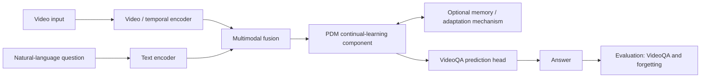

# PDM Framework

**A shared integration repository for collaborative multimodal continual learning**

> **Project:** Developing a Sustainable Collaborative Multi-modal Lifelong Learning Framework  
> **Organization:** [Collab-Multimodal-Lifelong-Learning](https://github.com/Collab-Multimodal-Lifelong-Learning)  
> **Status:** Integration planning / initial development  
> **Proposed pilot application:** Video Question Answering (VideoQA)

> [!IMPORTANT]
> This README is a **working development plan**, not a claim that the described system has already been implemented. The PDM model specification, integration interfaces, VideoQA benchmark, and continual-learning protocol require agreement among the participating teams. The full expansion of “PDM” has not yet been confirmed here.

## 1. Overview

This repository is the **single shared codebase** in which participating research teams jointly develop, assemble, evaluate, and demonstrate the integrated **PDM framework**.

Each team's independent research results—papers, experiments, and standalone implementations—remain in the corresponding research-domain repository. This repository is reserved for **components that are actually integrated into the common PDM system**, shared interfaces, end-to-end experiments, and the final application/demo.

Our long-term objective is to support **sustainable multimodal continual learning**: adapting to incoming tasks or data while preserving previously acquired knowledge, without requiring the entire system to be rebuilt from scratch each time.

### Relationship to the research repositories

| Repository | Primary purpose |
| --- | --- |
| `Continual-Learning-and-Multimodal-Integration` | Research on continual-learning modeling and multimodal integration |
| `Continual-Learning-Language-Domain` | Language-domain methods and research outputs |
| `Continual-Learning-Vision-Domain` | Vision-domain methods and research outputs |
| `Continual-Learning-Time-Series-Domain` | Time-series-domain methods and research outputs |
| **`PDM-Framework` (this repository)** | **One jointly maintained, runnable, integrated framework and application** |

A method developed in another repository should be brought here only when it has a clear role in the integration, a maintained interface, and a reproducible way to evaluate it.

## 2. Proposed first application: Continual VideoQA

As an initial integration target, we propose **Video Question Answering (VideoQA)**, in which a system answers natural-language questions about video content. VideoQA is a useful candidate because it connects **visual/temporal understanding**, **language understanding**, **multimodal reasoning**, and **continual adaptation** in a single application.

**Illustrative workflow**

1. Receive a video clip and a natural-language question.
2. Extract video/temporal features and encode the question.
3. Combine the modalities to produce an answer.
4. Introduce new video domains, question types, or tasks sequentially.
5. Adapt the PDM system using the agreed continual-learning method.
6. Evaluate answers on both **new** and **previously learned** settings to measure learning and forgetting.

> **Not yet decided:** The VideoQA dataset(s), answer format (multiple choice or open-ended), task/domain sequence, whether task IDs are available at inference time, and what parameters or memories may be updated. These decisions must be documented before reporting results.

### Conceptual pipeline (proposed)



This diagram shows **integration responsibilities**, not a finalized internal architecture. The positioning and implementation of the PDM component will be revised once its formal specification is agreed upon.

## 3. Scope of this repository

### In scope

- A common **training, adaptation, and inference pipeline** for the integrated PDM model.
- Video and text processing modules required by the selected VideoQA application.
- A well-defined interface for plugging in models or methods contributed by the research teams.
- Continual-learning task streams, data loaders, experiment configurations, and evaluation.
- Scripts and documentation for an **end-to-end VideoQA demonstration**.
- Reproducible baselines, integration tests, and release-ready artifacts approved for sharing.

### Out of scope

- Duplicating every team's paper-specific code or full experimental history.
- Uploading raw proprietary videos, private data, credentials, or unlicensed model weights.
- Treating proposed design choices or preliminary results as validated achievements.

## 4. Proposed repository structure

The following is a **target layout**. Directories and scripts will be added as implementation work begins.

```text
PDM-Framework/
├── README.md                  # Project scope, workflow, and documentation
├── docs/
│   ├── architecture.md        # Approved PDM architecture and interfaces
│   ├── integration.md         # Component ownership and integration guide
│   └── experiments.md         # Evaluation protocol and reproducibility
├── configs/                   # Version-controlled experiment configurations
├── pdm/
│   ├── encoders/              # Video / language encoders or adapters
│   ├── fusion/                # Multimodal fusion components
│   ├── continual/             # PDM updates, adaptation, and memory logic
│   ├── tasks/                 # VideoQA task and prediction interfaces
│   └── evaluation/            # VideoQA and continual-learning metrics
├── scripts/                   # Training, evaluation, and demo entry points
├── tests/                     # Unit and integration tests
└── examples/                  # Minimal reproducible examples
```

**Interface agreement before integration:** Each contributed component should document its input/output format, model dependencies, expected checkpoints, supported task scenarios, and a minimal test. Integration should rely on stable interfaces rather than copying disconnected research scripts.

## 5. Experiment and evaluation plan

We will use a **shared evaluation protocol** so that independently developed components can be assessed in the same end-to-end setting.

| Area | What to measure or document |
| --- | --- |
| **VideoQA quality** | Answer accuracy or the benchmark's official QA metric |
| **Continual learning** | Performance after each sequential task/domain; average performance across seen tasks |
| **Forgetting** | Change in performance on previously learned tasks after subsequent updates |
| **Adaptation** | Performance on newly introduced video domains or question types |
| **Efficiency** | Training/update cost, inference cost, and any memory/replay budget |
| **Reproducibility** | Data split, task order, random seed, model version, environment, and command used |

For a meaningful comparison, we should include at least an **initial/baseline model**, an **agreed continual-learning baseline**, and the **integrated PDM implementation** under matched settings. Exact metrics, baselines, and datasets will be finalized by the team; no benchmark result is claimed in this README.

### Minimum end-to-end demo

A first demonstrator is considered ready when another contributor can:

1. Obtain the documented, authorized dataset or a shareable toy example.
2. Set up the environment from the repository instructions.
3. Run VideoQA inference and inspect a predicted answer.
4. Run at least one sequential adaptation scenario.
5. Reproduce a before/after evaluation showing performance on earlier and later tasks.

## 6. Collaboration workflow

This is **one integration repository**, jointly owned by the participating teams. Research-domain repositories continue to serve as sources of individual results; the integration repository is the source of truth for the combined software.

1. **Create an Issue** describing a component, experiment, interface change, or integration problem. Include the expected output and acceptance criteria.
2. **Agree on the interface** before implementing a component that other teams depend on.
3. **Create a feature branch** (for example, `feat/video-encoder`, `feat/continual-adaptation`, or `eval/videoqa-baseline`).
4. **Open a Pull Request (PR)** with a concise summary, linked Issue, implementation notes, test results, and any external dependencies.
5. **Request review** from the relevant component contributor and an integration maintainer before merging.
6. **Keep `main` reproducible**: merge tested changes, update documentation, and avoid committing large datasets or secrets.

### Suggested contribution areas

| Workstream | Contribution |
| --- | --- |
| PDM integration | Agree on the PDM specification, shared interface, and update/training pipeline |
| Video / temporal modeling | Video loading, feature extraction, and temporal representation |
| Language / QA | Question encoding, answer prediction, and language-side evaluation |
| Multimodal modeling | Cross-modal fusion and integration with the common PDM pipeline |
| Evaluation / demo | Sequential VideoQA benchmark, forgetting analysis, reproducibility, and demonstration |

Assignments and maintainers are **to be decided**; the table lists workstreams rather than assigning responsibilities to any institution or person.

## 7. Using Claude Code for joint development

The team has discussed **Claude Code as a development assistant**. Its proposed role is to help contributors understand the shared codebase, implement well-scoped modules, create tests, and prepare PRs. **Claude Code is not, by itself, the PDM algorithm or the VideoQA model.** All suggested changes require human review and experimental validation.

**Suggested workflow for assisted development:**

1. Select an Issue with an agreed interface and measurable completion criteria.
2. Work on a dedicated feature branch and provide the assistant with the relevant module and specification.
3. Request a small, reviewable change **plus tests**, rather than an unverified repository-wide rewrite.
4. Run tests and experiments locally; verify model behavior, data handling, licenses, and dependencies.
5. Open a PR describing what was generated or assisted, what was manually checked, and what remains unverified.

Never paste private datasets, unpublished confidential material, credentials, or access tokens into an external assistant without appropriate authorization.

## 8. Integration milestones (proposed)

- [ ] **M0 — Specify:** Confirm the meaning/requirements of PDM, select the VideoQA application setting, and assign maintainers.
- [ ] **M1 — Baseline:** Deliver a minimal runnable VideoQA baseline and shared evaluation protocol.
- [ ] **M2 — Components:** Integrate the agreed video, language, multimodal, and continual-learning modules.
- [ ] **M3 — Continual VideoQA:** Run sequential tasks/domains with retention and adaptation measurements.
- [ ] **M4 — Demonstration:** Prepare a reproducible application demo, documentation, and approved public artifacts.

These milestones describe a **proposed workflow**, not completed deliverables or committed dates.

## 9. Decisions to confirm at the kickoff discussion

- **PDM specification:** What does PDM stand for, and what algorithmic behavior is required of the integrated model?
- **Application:** Is VideoQA the final initial demo, and what user-facing behavior should it show?
- **Benchmark:** Which VideoQA dataset, task sequence, domain shifts, and answer format will be used?
- **Learning protocol:** What is updated across stages, what replay/memory budget is permitted, and how will forgetting be measured?
- **Interfaces and ownership:** Which team maintains each component, and who reviews cross-module changes?
- **Release policy:** Which data, checkpoints, code, and results can be published publicly?

Please record decisions as GitHub Issues or in `docs/architecture.md` and update this README once the shared design is approved.

## 10. Getting started

The repository is currently intended as a **coordination and integration starting point**. Installation, training, and demo commands will be added after the initial implementation and dependencies are merged. Do not assume the proposed directories or scripts above already exist.

To participate, open an Issue for the workstream you plan to contribute to, coordinate the required interface, and submit changes through a Pull Request.

## Acknowledgments

This repository supports the joint research project **“Developing a Sustainable Collaborative Multi-modal Lifelong Learning Framework.”** Contributions from participating research teams will be credited alongside integrated modules and releases.
